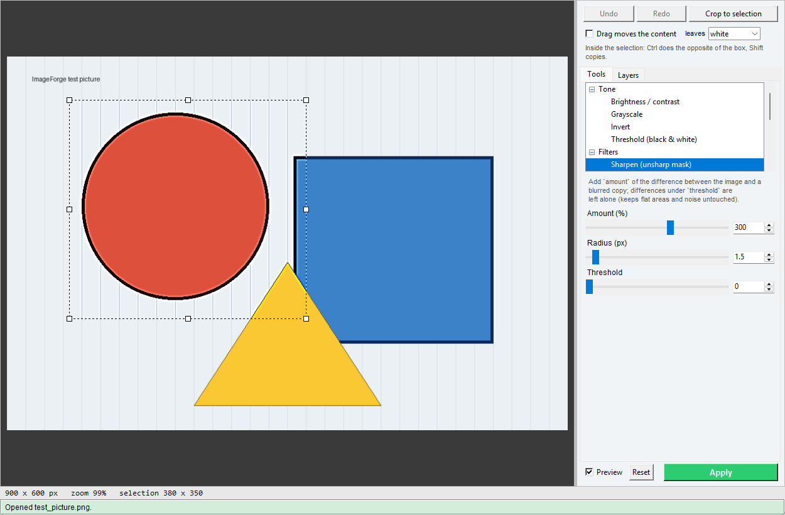

# ImageForge

A general-purpose image editor in one Tkinter window, built around small **plug-in tools**: adding a new
operation means adding one function. The window layout (fixed canvas with pan/zoom, side panel, undo history)
descends from the image-cleaning tab of [SpectrumDigitizer](https://github.com/milanone/SpectrumDigitizer).



## What it does now

- **Open / Save**: PNG, JPEG, TIFF, BMP, WebP, GIF and `.ifl` projects (drag a file onto the window, or
  `pythonw ImageForge.pyw image.png`). *Save* never overwrites the original: the first save asks for a new name
  (`<name>_edited.png`, or `<name>_edited.ifl` when there are layers).
- **Undo / Redo** of every step (Ctrl+Z / Ctrl+Y), limited to about 1 GB of history.
- **Move an object**: select it with a rectangle, tick **Drag moves the content** (or hold Ctrl) and drag inside the
  selection: the pixels move and the old place is filled with white, black or the border colour; Shift copies instead.
  One drag is one undo step. The object stops at the image border.
- **Layers** (tab *Layers*): pictures stacked over the Background, each with name, visibility, opacity (live while you
  drag the slider) and position (X, Y). Make one from the selection (*Edit > Copy / Cut selection to layer*, Ctrl+J /
  Ctrl+Shift+J: a cut leaves a hole filled like *leaves*), from a file with its transparency (*Open as layer...*) or with
  *Add text*. Raise, lower, duplicate, delete, *Merge down* (onto the layer below or the Background), *Flatten all*.
  The **Move layer** tool drags the selected layer on the image (arrow keys nudge it). Every change is an undo step.
- **Add text** (group Annotate): type the text (`\n` = new line), pick font, size, colour (type, **Pick** from the image or
  the colour dialog), rotation and opacity; click or drag on the image to place it, then *Add as layer*. The text stays
  editable: select its layer, change the boxes, press *Update layer* (select *Background* to add a second text).
- **Working area** (the box at the top of the right panel, drawn with the **Select** buttons at the top of the toolbox): press **Rectangle**
  *before* choosing any tool, drag a rectangle on the picture, and every tool, brush and rectangle tool acts only inside it (a coloured label
  shows its size and place; X / Y / W / H can be typed; **Whole image** removes it, Esc cancels a definition in progress). It works with any
  tool already selected, which the plain drag does not (a brush or a layer tool uses the drag for itself). It is the same rectangle as the
  selection below: you can still move or resize it with the handles, and Move area / Crop use it.
- **Shape selections** (same box; the **Magic wand** and **Lasso** buttons are in the toolbox): **Magic wand** (click a colour; *Tolerance* and *Contiguous* in the box; Shift adds, Ctrl removes,
  Shift+Ctrl keeps the overlap; Esc ends), **Lasso** (click the corners, or drag freehand; double-click, Enter or a click on the first
  point closes it; Shift adds, Ctrl removes), **Invert** (Ctrl+I), **Grow / Shrink** by N px and **Feather** (soft edge: tools then
  blend instead of cutting). The shape is the working area: every tool, brush, clone, Erase rectangle and layer respects it, the
  *Copy / Cut to layer* commands use it as the layer's transparency, and an outline of marching dashes shows it. Handles, nudging
  and *Move area* exist only for rectangles; *Crop to selection* uses the box around the shape.
- **Drawing tools** (group Draw): **Pencil** (hard, jagged pixels, round or square tip), **Paintbrush** (soft round brush with size,
  hardness and opacity; the opacity is that of the whole stroke, so it never gets darker where a stroke crosses itself), **Fill
  bucket** (tolerance, only the joined area or everywhere, widen by a few pixels to cover the pale edge of a line) and **Gradient**
  (linear, radial, reflected or angle; foreground to background, foreground fading to transparent, or the other way; shown while you
  drag). They paint with the **foreground colour** (the two squares above the picture: click one to choose; Ctrl+click on the picture
  picks the foreground, Ctrl+Shift+click the background; **X** swaps, **D** resets to black and white). Shift+click draws a straight
  line from where the last stroke ended. They work on the Background or on the selected image layer (paint over a transparent layer
  makes it opaque), and only inside the working area or shape selection. One stroke is one Undo step.
- **Shapes and scale bars** (group Annotate): *Shapes* draws a line, arrow, double arrow, rectangle or ellipse (colour, width, dashed or
  dotted, arrow head size, optional fill, opacity): drag on the image, press the button, and it is a **layer**, so you can restyle it,
  move it, or drag one of its two ends later (select its layer first). *Scale bar* draws a bar of a given length in the picture's
  units, with its label, as a layer too. The Background must be selected to add a second shape.
- **Scale and measurements** (menu *Measure*): the **Measure** tool measures a distance (drag), a path length (click the points,
  double-click or Enter ends), an angle (three clicks) or an area (polygon); the results are drawn on the picture (not part of it)
  and listed in *Measure > Measurements*, which can copy the table for a spreadsheet. **Calibrate from a measured length** (a known
  object or a ruler) gives the scale, which can also be typed or taken from the picture's dpi; then lengths and areas are given in
  real units, scale bars are the right size, and the scale is saved in a `.ifl` project. Measurements themselves are not saved.
- **History tab, recipes and batch**: the *History* tab lists every step of the picture; click one to go back (or forward) to it.
  A dot marks the steps a **recipe** can repeat on other pictures (tools applied to the whole picture or to a rectangle, and text /
  shape / scale-bar layers); brush strokes, moves and shape selections cannot be repeated and are listed as skipped. *Recipe > Save
  the steps so far* writes a `.ifr` file; *Run a recipe on this picture* applies one to the open picture; *Run a recipe on a folder*
  processes every picture of a folder (and its sub-folders, if asked) into another folder, in the same or a chosen format, with a name
  suffix and a JPEG quality, never over the originals unless told to. The same from a terminal:
  `python ImageForge.pyw --batch IN OUT --apply "Levels:gamma=1.4" --apply "Auto contrast" --format png --recursive`
  (or `--recipe file.ifr`); `python ImageForge.pyw --list-tools` lists the tools and their boxes.
- **Files**: *File > Open recent*, *Export...* (format, JPEG quality, PNG compression, longest side, dpi; the project is untouched) and
  *Edit > Paste* (Ctrl+V: a picture on the clipboard becomes a layer, or opens as the picture when nothing is open). The window
  size and place, the last folders and the recent files are remembered in `%APPDATA%\ImageForge\settings.json` (written when you
  close the program).
- **Where things are**: the mouse tools are in the **toolbox** at the left of the picture, as icon buttons in groups of two columns (hover for the
  name): **Select** (the arrow, Magic wand, Lasso, Hand) at the top: the arrow is the base state, *Select / move* (no tool: drag selects a rectangle, drag inside it moves what is inside, Shift copies, Ctrl moves the frame only); choosing it or clicking the tool in use a second time leaves the current tool, then **Draw** (Pencil, Paintbrush, Eraser brush, Fill bucket, Gradient), **Retouch** (Clone stamp, Clean brush, Dodge / burn, Erase rectangle, Move area),
  **Annotate** (Add text, Shapes, Scale bar, Measure) and **Layers** (Move layer). The one-shot
  operations with a preview and an Apply button are in the *Tools* tab of the panel: four buttons choose the group (**Size** = size and
  orientation, **Adjust**, **Filters**, **Clean-up**) and the list under them shows its tools; the box above them **finds a tool** by typing
  part of its name or group (Ctrl+K; Enter picks the first match; it finds the mouse tools too). The *Tools* and *Image* menus hold the same
  tools. A plug-in's group gets its own button after these.
- **Selection**: drag a rectangle; tools then act only inside it (a click outside it clears it). Drag inside it to move it,
  drag a handle (corners, edge midpoints) to resize it, arrow keys nudge it by 1 px (Shift: 10) once the image has been
  clicked. *Crop to selection*.
- **Keys**: `[` and `]` make the brush smaller or larger, `H` turns the Hand on and off, **Delete** / Backspace clears the selection (background colour, or transparent on a layer) and Shift+Delete fills it with the foreground colour, Shift+wheel scrolls sideways. None of them act while you type in a box.
- **Help > Keyboard shortcuts and mouse** (F1): every key and click combination, and whether it is the usual one in other editors (Photoshop, GIMP, Krita) or ours. Ctrl+Shift+Z also redoes.
- **Automatic fit**: the picture is fitted to the window when it is opened and every time the window (or the panel divider) is resized, until you zoom (wheel, Ctrl +/-, 100%) or pan by hand; the **Fit** button (shown pressed while the automatic fit is on) turns it on again.
- **View**: the bar above the picture has **Center** (middle of the window, same zoom), **Fit** (fill the window and
  centre) and **100%**, plus a **Hand** button: while it is pressed, or while you hold **Space**, dragging with the left
  button moves the picture instead of selecting (right/middle drag always moves it). Wheel = zoom at the cursor.
  The status line shows the pixel under the cursor. The tool list is tall (about 20 rows); the line between it and the parameters below can be dragged.
- **Tools**, with live preview:
  - Tone: brightness / contrast, grayscale (with strength), invert, threshold (plug-in example)
  - Filters: sharpen (unsharp mask), Gaussian blur
  - Geometry: auto-crop borders (uniform white / black / frame colour, tolerance, margin), rotate 90/180, rotate by any angle (with **Measure**: click two points of a line to level it), flip,
    resize (percent or pixels, choice of interpolation)
  - Retouch: **Clone stamp** (define the **source** first: press *Set source* and click on the picture, or type X / Y, or
    Ctrl+click while painting; a cyan cross marks it and follows the cursor while you paint. Then paint where the copy should
    go: soft edge, opacity, *Aligned* keeps the offset between strokes) and **Clean brush** (paint over a spot, scratch or stray
    mark, it shows red; when you let go it is rebuilt from its surroundings). Both are limited to the selection and work on the
    selected layer's pixels.
  - Size: **Upscale (local, free)** makes the picture 2x or 4x larger with Real-ESRGAN or waifu2x (the `-ncnn-vulkan` command-line programs, which you download
    yourself and which need a GPU with Vulkan; *Tools > AI programs folder...* tells ImageForge where they are). It runs in the background (the window stays
    usable, Esc stops it; a progress bar and the time left are shown, read from the program's own percentages) and can take minutes: about 2.5 min per megapixel with Real-ESRGAN on an integrated Intel GPU. The detail it adds is invented, not
    recovered. It does **not** remove objects.
  - Clean-up: **Remove object (local, free)** is a 'magic eraser' (a neural network, LaMa, that runs on your computer and sends nothing anywhere): select the object with the Lasso, Magic wand or Rectangle and press Apply; the selection (widened
    by about 12 % so the tint and reflection of glass or a bottle go too) is rebuilt from its surroundings by the LaMa neural network, on the CPU. It needs
    `pip install onnxruntime` and the LaMa model (`lama_fp32.onnx`, about 208 MB, e.g. the ONNX conversion at huggingface.co/Carve/LaMa-ONNX; check its
    licence before redistributing it), which you put with the other AI programs; *Tools > AI programs folder...* tells ImageForge where and remembers it.
    The first run of a session spends about a minute loading the model, then about ten seconds per piece; the window stays usable and Esc stops it. The fill
    is invented, plausible rather than true, and a little smoother than the photograph.
  - Clean-up: **Remove object (API, paid)** is the other 'magic eraser': it sends a crop to an online service and redraws what was behind an object with a large generative model (Google Gemini image models through
    [OpenRouter](https://openrouter.ai)). **It costs money**: about 0.04 USD per object, charged to your OpenRouter credit, which the panel shows (*Refresh
    credit*). Select the object, describe it in words (or leave the box empty: the object at the centre of the crop, which is the one you selected, is removed), press Apply: a window shows what will be sent (only a crop around the object, never the whole picture; you
    are warned if a face is in it), the estimated cost and your credit, and nothing is sent until you say yes. The answer is aligned to the original and pasted
    back only over the object, so the rest of the picture is unchanged. Set the key once with
    `[Environment]::SetEnvironmentVariable('OPENROUTER_API_KEY','your-key','User')`; it is never shown, saved or logged by ImageForge. *Help > Guide: removing
    objects* explains which of the four removal tools to use, how to use this one, tips, money, privacy and limits. What the model draws is invented
    (plausible, not true).
  - Adjustments: **Portrait retouch**, a one-step portrait finish: it finds the faces (OpenCV's frontal-face detector). When it misses some (a profile, a tilted or
    partly cut face), **Find faces** writes what it found in a list, **Mark faces** (or Ctrl+click) adds the ones you click on, and the list can be
    edited by hand; yellow outlines show the faces on the picture, smooths the skin only where the colour is skin (eyes, lips, hair and glasses stay sharp), lifts
    the light on the face, shifts its warmth, and darkens the surroundings round a wide soft pool of light. Keep the amounts low.
  - Retouch: **Dodge / burn** lightens or darkens by hand, as in a darkroom (faces, eyes, folds): choose *dodge* or *burn*, the tones it
    works on (midtones, shadows, highlights, all), the exposure, the size and the softness of the brush. The exposure belongs to the whole
    stroke; a second stroke adds more. Colours are kept and nothing clips.
  - Areas: **Erase rectangle** (drag a rectangle, what is inside is erased on release: white, black, a colour **picked from the
    picture** (Pick) or chosen with a dialog (...), transparent on a layer, or inpainted) and **Move area** (drag a rectangle round something, then drag inside it to move it; Shift or its
    *Copy* box copies; the old place is filled as the *leaves* box says; on an image layer it works inside that layer)
- **Ctrl+click as a shortcut for Pick**: with a tool that has a Pick / Set source button, Ctrl+click on the picture does what the button
  does, without pressing it: the Clone stamp source, a colour to find (Erase / keep colours, Remove marks: added to the list), the
  colour to paint with (Eraser brush, Erase rectangle, Add text), and Ctrl+Shift+click the *paint with* colour of Erase / keep colours.
  - Adjustments: **Levels** (per channel or all; black / white points, gamma, output range), **Curves** (smooth monotone curve
    through five points), **Auto contrast** (with a clip percentage, one stretch or per channel), **Local contrast (CLAHE)**,
    **Even out illumination** (removes a slow brightness gradient), **Hue / saturation**, **Colour balance** (shadows / midtones /
    highlights) and **White balance** (pick a grey, gray world or brightest areas). *View > Histogram* (Ctrl+H) shows the values of
    the picture as it is now, preview included, per colour and as lightness, with log scale and a *working area only* option; with
    Levels open its black and white points are drawn on it.
  - Filters and corrections: **Reduce noise** (median, bilateral, non-local means), **Morphology** (dilate, erode, open, close,
    outline, top-hat, black-hat), **Find edges** (Canny, Sobel, Laplacian), **Auto straighten** (finds the tilt of text, rules or
    straight edges and rotates it level; the angle is shown after Apply), **Perspective correction** (click the four corners of a
    page or slide seen at an angle), **Canvas size** (add or cut borders; layers keep their place), **Crop to aspect ratio** (1 : 1,
    3 : 2, 16 : 9 ..., from the centre or a side) and **Lens distortion** (barrel / pincushion).
  - Clean-up (ported from SpectrumDigitizer): erase / keep colours (**Pick** colours on the image, with tolerance and an
    optional widening of the area; paint with white, black, a **picked colour** (Pick it from the picture, or choose it), transparent or **inpaint**, which rebuilds the erased pixels from
    their surroundings so a line over a gradient or a photo fades into it - keep the area narrow, a wide hole gets smeared),
    **Remove marks** (pick the colour of small marks such as the red stars on a scheme: they are taken out with their fringe and
    what lay under them is rebuilt: the shading is filled side by side, and the dark outlines that enter a mark are joined to the ones
    that leave it, so rings, dividers and corners run on through; a line that runs along a mark rather than into it may need a touch-up
    with the Clone stamp), despeckle, flatten ink to one colour, join dashed lines (smooth strokes that follow the dashes), eraser brush (drag on the image; white, black, a picked colour or transparent; one stroke = one undo step)

Geometry tools change the whole image and ignore the selection; all other tools, the eraser brush included, are limited to it.
The selection takes the place of SpectrumDigitizer's working area (which could also be rotated: not ported).

**Tools act on what is selected in the Layers tab.** With the Background selected (or no layers) they change the
Background; with an *image layer* selected they change that layer's own pixels (its transparency is kept; the live
preview and the selection work as usual, the selection being cut to the layer). The eraser brush and *Erase / keep
colours* have a **transparent** option for the paint: on a layer it erases to see through, on the Background it paints
white. A *text layer* is not made of pixels: pixel tools refuse it (edit it with Add text, or merge it down first).
*Drag moves the content* and *Cut/Copy to layer* work from the Background.

**Rotate, flip and resize a single layer**: select an image layer and use *Rotate 90 / 180*, *Rotate (any angle)* (with
live preview and the **Measure** button), *Flip* or *Resize* (percent or pixels): the layer is transformed around its own
centre, its transparency is kept, and the new corners of a rotation are transparent (no light fringe at the edges). With the
Background selected these tools change the whole picture and, if there are layers, ask to merge them first (so does
*Auto-crop borders*); *Crop to selection* keeps the layers.

**Projects**: *Save* with layers writes an `.ifl` project (a zip: `manifest.json`, `background.png`, one PNG per image
layer; text layers keep their text, font and colour), which reopens with all layers and editable text. Saving as PNG/JPEG
etc. writes the flattened picture and does not count as saved while layers exist (closing still asks). Ctrl+S goes back
to the project once there is one; an image file is never overwritten silently.

## Adding a tool

Drop a `.py` file into `plugins/` (see [plugins/example_threshold.py](plugins/example_threshold.py)); it is loaded at
start-up and shows up in the tool list with sliders, boxes and a live preview generated from its parameters:

```python
@tool("Sepia", "Tone", [Param('strength', "Strength (%)", 'int', 100, 0, 100, slider=True)])
def sepia(img, strength):
    ...        # img: (H, W, 3) uint8, never modified in place
    return new_img
```

A broken plug-in is reported on the console and skipped. The same decorator works inside `ImageForge.pyw` for tools
that should ship with the program.

## Limits (what is and is not verified)

- Images are held as **8-bit RGB**: transparency is flattened onto white, 16-bit / grey / palette / CMYK are converted,
  and ICC profiles are not kept. EXIF orientation is applied on load; other metadata is dropped on save, except dpi.
- Tested on synthetic images and a scripted session with real Tk mouse events (selection drag, colour pick, angle pick,
  brush strokes, apply, crop, undo/redo, zoom, pan); the clean-up tools have not been tried on real scans yet; the unit tests
  cover the tools, history, file round-trips and plug-ins. Not tried on very large photos: the live preview recomputes
  the whole image, so heavy filters can lag on tens of megapixels (turn Preview off).
- JPEG is saved at quality 95 without chroma subsampling; there is no quality dialog yet.

## If something does nothing

Painting tools (eraser, clone, clean) and the rectangle tools only touch the **selection**, if there is one, and the
**selected layer**: press **Esc** to drop a selection left by another tool, and click **Background** in the Layers tab to work on
the picture itself. The status line at the bottom says what is limiting a stroke and why it changed nothing. If the program
raises an internal error (there is no console with `pythonw`), the message appears there too and the details are appended to
`ImageForge_errors.log` next to the program: send me that file.

## Requirements and tests

`pip install -r requirements.txt` (numpy, Pillow, OpenCV; tkinterdnd2 optional). Run the tests with
`python -m unittest discover -s tests -v`. `python examples/make_screenshot.py` regenerates the screenshot.

## Licence

MIT, see [LICENSE](LICENSE).
